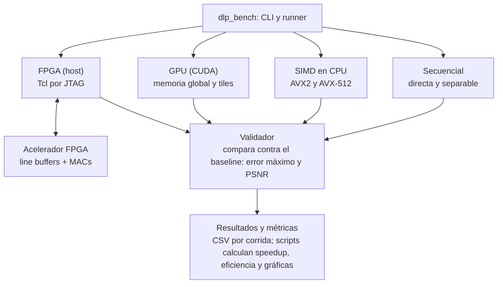

# Milestones de implementación — Framework DLP

El framework se construye en 5 milestones funcionales (F1 a F5): primero el esqueleto común y el baseline, después SIMD y GPU con sus mediciones, y al final el acelerador FPGA cuando tengan acceso a la tarjeta.

## Arquitectura del framework

Todos los backends implementan la misma interfaz y reciben la misma imagen y filtro, así que agregar una variante nueva solo requiere un archivo en `backends/`.

## Milestones funcionales

### F1 · Esqueleto del framework (22–28 oct)

Terminado cuando `dlp_bench --backend seq --size 1024` corre y escribe una imagen de salida.

- [ ] Estructura en `proyecto_2/`: `common/`, `backends/seq`, `backends/simd`, `backends/cuda`, `backends/fpga`, `scripts/`, `tests/`
- [ ] Build con CMake y flags por backend (`-mavx2`, `-mavx512f`, `nvcc`) activables por opción
- [ ] Interfaz común de backend: `init`, `run(imagen, filtro, salida)`, `cleanup`
- [ ] Lectura y escritura de imágenes PGM en escala de grises y generador de imágenes sintéticas por tamaño y semilla
- [ ] CLI con backend, tamaño, filtro, repeticiones y archivo de salida
- [ ] Stub en backends/fpga que responde "no disponible", para que el runner funcione sin la tarjeta

### F2 · Baseline y validación (29 oct–5 nov)

Terminado cuando el baseline produce resultados verificados y el runner genera un CSV con tiempos.

- [ ] Baseline secuencial en dos variantes: convolución directa y separable, Gaussiano 5×5 y Sobel 3×3
- [ ] Manejo de bordes definido (por ejemplo replicar el borde) y documentado, igual en todos los backends
- [ ] Validador: compara contra el baseline píxel a píxel y reporta error máximo absoluto y PSNR
- [ ] Runner de benchmarks: calentamiento, N repeticiones, mediana y desviación, salida en CSV
- [ ] Exportar imágenes de prueba y salidas del baseline en formato .hex, para reutilizarlas después en la FPGA

### F3 · SIMD y GPU (6–19 nov, Demo 2)

Terminado cuando SIMD y CUDA tienen sus 2 propuestas y ambas pasan el validador.

- [ ] SIMD propuesta 1: convolución directa con intrinsics AVX2
- [ ] SIMD propuesta 2: convolución separable y variante AVX-512 (Intel 11va gen); comparar contra AVX2 en la 9na gen
- [ ] CUDA propuesta 1: un hilo por píxel leyendo de memoria global
- [ ] CUDA propuesta 2: tiles en memoria compartida con halo y tamaño de bloque configurable
- [ ] Runner llama a seq, SIMD y CUDA con el mismo comando
- [ ] Pruebas de correctitud automatizadas para los 3 backends y varios tamaños

### F4 · Medición de CPU y GPU (20–26 nov)

Terminado cuando un solo script produce las tablas y gráficas de CPU y GPU.

- [ ] Barrido de tamaños (por ejemplo 512², 1024², 2048², 4096²) en todas las máquinas
- [ ] Cálculo automático de speedup, eficiencia paralela y escalabilidad desde los CSV
- [ ] Perfilado: perf o VTune en CPU y Nsight Compute en GPU
- [ ] Tabla de diferencias numéricas CPU vs. GPU
- [ ] Opcional: misma corrida en GPU integrada (OpenCL en Intel o Metal en el M3)

### F5 · Acelerador FPGA (en cuanto haya acceso a la tarjeta, a más tardar 27 nov–3 dic)

Terminado cuando la FPGA procesa la imagen completa, pasa el validador y aparece en las mismas tablas que CPU y GPU.

- [ ] Proyecto Quartus y ISA mínimo definido
- [ ] Datapath con line buffers, ventana deslizante y MACs, simulado con testbench contra los .hex del baseline
- [ ] Decodificador de instrucciones, memoria en chip y contador de ciclos
- [ ] Transferencia PC → FPGA → PC por JTAG e imagen completa procesada por bloques
- [ ] Backend FPGA conectado al runner, en lugar del stub
- [ ] Medición con contador de ciclos y SignalTap; diferencias numéricas contra CPU y GPU
- [ ] Merge a master y tag de la versión final

