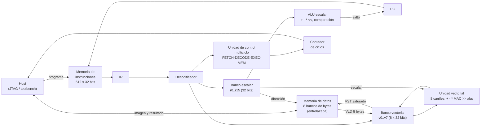

# VPROC: procesador vectorial para la FPGA

El acelerador de la FPGA es un procesador pequeño con su propio ISA, y no un bloque de función fija. El host (el PC por JTAG, o el testbench en simulación) carga un programa y una imagen, da la orden de inicio y lee el resultado y el contador de ciclos. El Gaussiano 5×5 y el Sobel 3×3 son programas escritos en ese ISA, con bucles, saltos y aritmética de direcciones.

Respecto a la Demo 1 cambia lo siguiente. Antes había 4 comandos (`LDK`, `CFG`, `CONV`, `HALT`) y `CONV` hacía toda la convolución en hardware fijo. Ahora hay 20 instrucciones, con registros, PC, decodificador y unidad de control, y la convolución se arma con operaciones vectoriales elementales.

## Arquitectura



| Bloque | Archivo | Qué hace |
|---|---|---|
| Núcleo | `rtl/vproc_core.v` | Une todo: PC, IR, bancos de registros, conexión con memorias, contador de ciclos |
| Decodificador | `rtl/vproc_decoder.v` | Separa los campos y genera las señales de control (combinacional) |
| Unidad de control | `rtl/vproc_control.v` | Máquina de estados multiciclo; CPI 3 (4 para `VLD`) |
| ALU escalar | `rtl/vproc_alu.v` | Direcciones, contadores de bucle y comparaciones para saltos |
| Unidad vectorial | `rtl/vproc_vector_unit.v` | `LANES` carriles idénticos que aplican la misma operación (SIMD) |
| Memoria de datos | `rtl/vproc_dmem.v` | `LANES` bancos de bytes; `VLD`/`VST` no alineados en 1 acceso |
| Memoria de instrucciones | `rtl/vproc_imem.v` | Lectura síncrona; la escribe el host |

Parámetros: `LANES = 8` (carriles), `IMEM_WORDS = 512`, `DMEM_BYTES = 16384` (64 KiB en el testbench).

### Por qué una memoria entrelazada

La convolución lee la misma fila desplazada 0, 1, 2, 3 y 4 píxeles. Con una memoria de 8 bytes por palabra, un acceso no alineado necesitaría dos lecturas y un reacomodo. Con 8 bancos de un byte, el byte `A` vive en el banco `A mod 8`, de modo que 8 bytes consecutivos caen en 8 bancos distintos y se leen en un solo ciclo, empiece donde empiece la dirección. Cada banco es un bloque de RAM de la FPGA.

### Multiplicadores

`VMULS` y `VMACS` multiplican los 18 bits bajos del carril por los 16 bits bajos del escalar, ambos con signo, así que cada carril usa un solo multiplicador 18×18 de la FPGA. Para estos filtros alcanza: el producto más grande es 4080 × 6.

## Formato de instrucción

Todas las instrucciones miden 32 bits:

```
 31      26 25   22 21   18 17   14 13                 0
+----------+-------+-------+-------+--------------------+
|  opcode  |  rd   |  rs   |  rt   |   imm (14 bits,    |
|  6 bits  | 4 bits| 4 bits| 4 bits|    con signo)      |
+----------+-------+-------+-------+--------------------+
```

- Registros escalares `r0..r15` de 32 bits; `r0` siempre vale 0.
- Registros vectoriales `v0..v7` con 8 carriles de 32 bits con signo (se usan los 3 bits bajos del campo).
- Los saltos son relativos al PC de la propia instrucción y se miden en instrucciones.

## Instrucciones

| Opcode | Mnemónico | Operación | Clase |
|---|---|---|---|
| 0x00 | `NOP` | nada | control |
| 0x01 | `HALT` | termina; el host ve `done = 1` | control |
| 0x02 | `ADD rd, rs, rt` | `r[rd] = r[rs] + r[rt]` | escalar |
| 0x03 | `SUB rd, rs, rt` | `r[rd] = r[rs] - r[rt]` | escalar |
| 0x04 | `MUL rd, rs, rt` | `r[rd] = r[rs] * r[rt]` (32 bits bajos) | escalar |
| 0x05 | `ADDI rd, rs, imm` | `r[rd] = r[rs] + imm` | escalar |
| 0x06 | `SLLI rd, rs, imm` | `r[rd] = r[rs] << imm` | escalar |
| 0x07 | `RDCYC rd` | `r[rd] = ciclos desde el inicio` | escalar |
| 0x08 | `BNE rs, rt, etiqueta` | si `r[rs] != r[rt]`: `pc += imm` | salto |
| 0x09 | `BLT rs, rt, etiqueta` | si `r[rs] < r[rt]` (con signo): `pc += imm` | salto |
| 0x0A | `JMP etiqueta` | `pc += imm` | salto |
| 0x10 | `VLD vd, imm(rs)` | `v[vd][i] = mem[r[rs] + imm + i]` (byte sin signo), i = 0..7 | memoria |
| 0x11 | `VST vd, imm(rs)` | `mem[r[rs] + imm + i] = sat_0_255(v[vd][i])` | memoria |
| 0x12 | `VADD vd, vs, vt` | `v[vd] = v[vs] + v[vt]` | vectorial |
| 0x13 | `VSUB vd, vs, vt` | `v[vd] = v[vs] - v[vt]` | vectorial |
| 0x14 | `VMULS vd, vs, rt` | `v[vd] = v[vs] * r[rt]` | vectorial |
| 0x15 | `VMACS vd, vs, rt` | `v[vd] = v[vd] + v[vs] * r[rt]` | vectorial |
| 0x16 | `VADDI vd, vs, imm` | `v[vd] = v[vs] + imm` | vectorial |
| 0x17 | `VSRAI vd, vs, imm` | `v[vd] = v[vs] >>> imm` (aritmético) | vectorial |
| 0x18 | `VABS vd, vs` | `v[vd] = abs(v[vs])` | vectorial |
| 0x19 | `VBCAST vd, rs` | `v[vd][i] = r[rs]` en los 8 carriles | vectorial |

El ensamblador agrega dos pseudoinstrucciones: `LI rd, valor` (se expande a `ADDI`, `SLLI`, `ADDI`, para valores de 0 a 2^25 − 1) y `MOV rd, rs` (`ADDI rd, rs, 0`).

## Ciclos por instrucción

| Estado | Qué pasa |
|---|---|
| FETCH | el PC va a la memoria de instrucciones |
| DECODE | la instrucción entra al IR |
| EXEC | lectura de registros, ALU o unidad vectorial, siguiente PC, escritura; `VST` escribe la memoria |
| MEM | solo `VLD`: los bancos entregan los 8 bytes y se escriben en `vd` |

## Protocolo con el host

1. Con el núcleo detenido, el host escribe el programa en la memoria de instrucciones y la imagen en la de datos.
2. Un pulso en `start` arranca el núcleo en PC = 0 con el contador de ciclos en 0.
3. El host espera `done = 1`. Si `error = 1`, el núcleo encontró una instrucción ilegal.
4. El host lee la imagen de salida y `cycles`.

El host agrega el borde replicado antes de cargar la imagen: para un filtro de radio R, carga una imagen de (W + 2R) × (H + 2R). Así el programa no revisa bordes en el bucle interno, y el resultado es idéntico al baseline, que replica el borde con *clamp*.

Mapa de memoria de datos que usa `run_sim.py`: la entrada con borde va en `IN = 0` y la salida justo después, en `OUT = (W + 2R)(H + 2R)`.

## Programas

| Programa | Qué calcula | Instrucciones por 8 píxeles | Ciclos por píxel |
|---|---|---|---|
| `programs/gauss5.s` | Gaussiano 5×5 separable en registros, `(acc + 128) >> 8` | 69 (25 de ellas `VLD`) | ≈ 29.3 |
| `programs/sobel3.s` | Sobel x 3×3, `VABS` y saturación de `VST` | 25 (6 `VLD`) | ≈ 9.3 |
| `programs/smoke.s` | Ejecución dummy: suma 1 a 16 píxeles con saturación | — | — |
| `programs/isa_test.s` | Ejercita las 20 instrucciones y compara 64 bytes | — | — |

## Cómo simular

Requisitos: `python3` e Icarus Verilog (`sudo apt install iverilog`). Desde `proyecto_2/`:

```bash
make fpga_test                         # ISA, dummy, Gauss y Sobel en 32x32 y 64x64
make fpga_sim FILTER=gauss SIZE=64     # un caso; FILTER también acepta smoke e isa
python3 fpga/scripts/run_sim.py --filter sobel --size 32 --vcd   # con formas de onda
```

`run_sim.py` hace lo siguiente:

1. Usa `dlp_bench --backend seq --hex-dir` para exportar la entrada y la salida del baseline.
2. Ensambla el programa con `W`, `H`, `WP`, `IN` y `OUT`.
3. Compila con `iverilog` y ejecuta el testbench, que compara píxel a píxel.

Todo queda en `build/fpga/`: el listado `.lst`, la salida `*_fpga_out.hex` y las ondas `.vcd`.

## Resultados en simulación

Validación contra `seq` con tolerancia 0, en todos los casos sin diferencias:

| Caso | Píxeles | Ciclos | Ciclos/píxel | Tiempo a 50 MHz |
|---|---|---|---|---|
| Gauss 32×32 | 1024 | 30 425 | 29.71 | 0.61 ms |
| Gauss 64×64 | 4096 | 120 185 | 29.34 | 2.40 ms |
| Gauss 120×120 | 14 400 | 420 177 | 29.18 | 8.40 ms |
| Sobel 32×32 | 1024 | 9 942 | 9.71 | 0.20 ms |
| Sobel 64×64 | 4096 | 38 262 | 9.34 | 0.77 ms |
| Sobel 96×96 | 9216 | 85 014 | 9.22 | 1.70 ms |

Los ciclos crecen de forma lineal con el número de píxeles: el costo fijo (cargar constantes, recorrer filas) se diluye y los ciclos por píxel bajan un poco con el tamaño.

## Dos propuestas de microarquitectura

| | Propuesta 1 (implementada) | Propuesta 2 (siguiente paso) |
|---|---|---|
| Control | Multiciclo, CPI 3–4 | Pipeline de 4 etapas, CPI ≈ 1 |
| Ventana | 25 `VLD` por grupo de 8 píxeles (reutiliza poco) | Registro de desplazamiento o line buffer: 1 `VLD` por fila nueva |
| Recursos | 8 multiplicadores 18×18, 8 bancos de RAM | igual más registros de pipeline y riesgos de datos |
| Ciclos/píxel Gauss (estimado) | 29.3 (medido) | alrededor de 8 a 10 con pipeline; menos con reutilización de ventana |
| Complejidad | baja; fácil de verificar | riesgos de datos y de control, *forwarding* |

La propuesta 1 sirve como referencia correcta y mide el costo de la reutilización pobre de datos: el 36 % de las instrucciones del Gauss son `VLD`, y cada `VLD` cuesta 4 ciclos.

## Pendiente para la tarjeta

- Proyecto Quartus con un *top* para la tarjeta del curso: reloj, reset y puente JTAG hacia los puertos `host_*`, por ejemplo un JTAG-to-Avalon master de Platform Designer o el In-System Memory Content Editor.
- Backend `fpga` en C++ que haga lo mismo que el testbench por JTAG, en lugar del stub actual.
- Procesar imágenes grandes por franjas que quepan en la memoria en chip.
- Medición con el contador de ciclos y SignalTap, y diferencias numéricas contra CPU y GPU.
