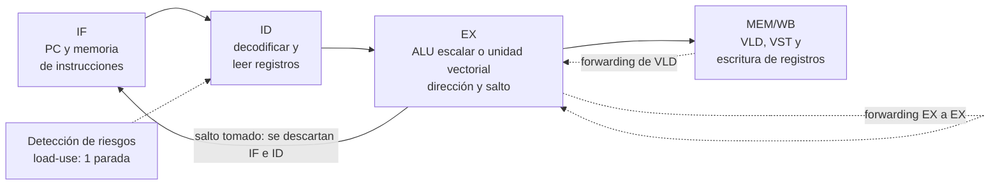

# Dos propuestas de microarquitectura para el acelerador FPGA

El enunciado pide al menos dos propuestas por diseño, detalladas y comparadas según criterios. Este documento compara la propuesta 1 (multiciclo, implementada y medida en la DE1-SoC) con la propuesta 2 (pipeline de 4 etapas, **documentada y estimada, no implementada**: el equipo decidió dejarla solo en diseño).

Todo lo marcado como *medido* sale de la tarjeta; lo marcado como *estimado* sale de un modelo que se valida contra esas mediciones (sección 5).

## 1. Qué se descompone y cómo

Ambas propuestas usan la misma descomposición, por dominio de datos (ver `ISA.md`):

- La imagen se parte en **franjas de filas** que caben en la memoria de datos de 64 KB (lo hace el backend en el host).
- Dentro de una franja, cada instrucción vectorial procesa **8 píxeles de salida** a la vez, uno por carril. Los píxeles de salida son independientes entre sí, así que no hay dependencias entre carriles.
- La memoria de datos es entrelazada en 8 bancos de un byte, de modo que `VLD` lee 8 bytes consecutivos desde cualquier dirección en un solo acceso.

Lo que cambia entre propuestas es **cómo se ejecuta la secuencia de instrucciones**, no qué se calcula. Por eso el ISA, los programas (`gauss5.s`, `sobel3.s`) y el backend del host se mantienen.

## 2. Propuesta 1: multiciclo (implementada, medida)

Cada instrucción pasa por FETCH, DECODE y EXEC (3 ciclos), y `VLD` agrega un ciclo MEM (4). Hay una sola instrucción en vuelo.

| Dato | Valor | Fuente |
|---|---|---|
| Ciclos por píxel, Gauss | 29.1 (512²) | medido, `results/fpga/` |
| Ciclos por píxel, Sobel | 9.06 (512²) | medido, `results/fpga/` |
| Kernel a 512², Gauss / Sobel | 152.6 ms / 47.5 ms | medido (ciclos / 50 MHz) |
| CPI | 3.251 (Sobel 32²) | medido, SignalTap |
| Bucle interno de Sobel | 22 instrucciones, 6 `VLD`, 72 ciclos por 8 píxeles | medido, SignalTap |
| Ocupación de la FSM (Sobel) | FETCH 30.8 %, DECODE 30.8 %, EXEC 30.8 %, MEM 7.7 % | medido, SignalTap |
| Memoria y escalares | 34.8 % de los ciclos en memoria; 31.9 % de las instrucciones son escalares | medido, SignalTap |
| Recursos (diseño con JTAG) | 7 341 ALMs (23 %), 66 bloques M10K (17 %), 10 DSP (11 %), 8 500 registros | reporte de Quartus |
| Reloj | 50 MHz; Fmax 63.04 MHz, slack de setup +4.138 ns | reporte del Timing Analyzer |

**Cuello de botella.** Con CPI 3.25, el 61.6 % de los ciclos (FETCH 30.8 % más DECODE 30.8 %) se gastan en etapas que no hacen cálculo. Casi un tercio de las instrucciones es aritmética de direcciones y de bucle, y solo un tercio es cómputo vectorial.

## 3. Propuesta 2: pipeline de 4 etapas (documentada, estimada)



**Qué cambia en el RTL**

| Bloque | Cambio |
|---|---|
| Unidad de control | La FSM multiciclo se reemplaza por 4 etapas y señales de control que viajan por los registros de pipeline |
| Registros de pipeline | IF/ID, ID/EX, EX/MEM y MEM/WB. Los vectoriales pesan: ID/EX guarda 3 operandos vectoriales de 256 bits |
| Forwarding | Multiplexores EX a EX y MEM/WB a EX, con rutas para los registros escalares y los vectoriales |
| Detección de riesgos | Si la instrucción que sigue a un `VLD` usa su destino, se detiene una vez |
| Saltos | Se resuelven en EX. Si se toman, se descartan las dos instrucciones captadas detrás (2 burbujas) |
| Sin cambios | ISA, decodificador, ALU escalar, unidad vectorial, memorias entrelazadas, puente JTAG, contador de ciclos y backend del host |

**Riesgos de datos**

| Riesgo | Tratamiento | Costo |
|---|---|---|
| Resultado de ALU usado por la siguiente instrucción | Forwarding EX a EX | 0 |
| Dato de `VLD` usado por la siguiente instrucción | Forwarding desde MEM/WB, el dato llega una etapa más tarde | 1 parada |
| Dato de `VLD` usado dos instrucciones después | Forwarding desde MEM/WB | 0 |
| Salto tomado | Descartar IF e ID | 2 burbujas (1 si se resuelve en ID) |
| `VMACS` encadenados sobre el mismo acumulador | Forwarding EX a EX | 0 |

**Estimación (modelo, sección 5).** Mismas imágenes y mismos programas:

| Filtro | Tamaño | P1 ciclos | P2 ciclos | Mejora | Ciclos/px P1 | Ciclos/px P2 | P2 con todas las paradas ocultas |
|---|---|---|---|---|---|---|---|
| Gauss | 128² | 477 881 (medido) | 197 523 | 2.42x | 29.17 | 12.06 | 146 323 (3.27x) |
| Gauss | 512² | 7 612 985 (modelo de una franja) | 3 149 331 | 2.42x | 29.04 | 12.01 | 2 330 131 (3.27x) |
| Sobel | 128² | 150 198 (medido) | 56 210 | 2.67x | 9.17 | 3.43 | 50 066 (3.00x) |
| Sobel | 512² | 2 370 102 | 888 338 | 2.67x | 9.04 | 3.39 | 790 034 (3.00x) |

Los ciclos de P1 a 512² son los del modelo de una sola franja. En la tarjeta el tamaño se procesa en varias franjas y se midieron 7 628 300 (Gauss) y 2 375 165 (Sobel), aproximadamente 0.2 % más. A 50 MHz y 512², la P2 tardaría unos 63 ms en Gauss y 17.8 ms en Sobel, contra 152.6 y 47.5 ms de la P1. Con las paradas ocultas, 46.6 y 15.8 ms. Si el salto se resuelve en ID (1 burbuja), la mejora sube unas décimas (por ejemplo Sobel 512²: 2.77x).

**De dónde salen las paradas.** En Gauss, cada uno de los 25 `VLD` por iteración tiene su consumidor justo detrás, así que hay una parada por `VLD`. En Sobel hay 3 por iteración, una por fila de la ventana (`VLD v2` seguido de `VSUB`). Un ensamblador que reordene las instrucciones, por ejemplo adelantando el siguiente `VLD` o la actualización de `r8`, oculta esas paradas. Eso no cambia el RTL, solo los programas, y da la última columna de la tabla.

**Reutilización de ventana.** Se evaluó y no se incluye en la P2. Con un solo puerto de memoria y un pipeline donde `VLD` cuesta 1 ciclo, cambiar un `VLD` por una instrucción de desplazamiento entre vectores no ahorra ciclos. En la P1 el ahorro sería de 1 ciclo por `VLD` sustituido (3 de 72 en Sobel, 4 %). Una ventana con *line buffer* dedicado, que entregue todos los taps a la vez, sí cambiaría el costo, pero es una arquitectura de flujo de datos aparte y no un procesador con ISA.

**Alternativa ortogonal.** `LANES` es un parámetro del RTL. Subirlo de 8 a 16 reduciría a la mitad las iteraciones, con más DSP y bancos de memoria. No se evaluó aquí.

## 4. Comparación por criterios

| Criterio | Propuesta 1 (multiciclo) | Propuesta 2 (pipeline) |
|---|---|---|
| Ciclos por píxel, Gauss | 29.1 (medido) | 12.0 (9.1 con paradas ocultas), estimado |
| Ciclos por píxel, Sobel | 9.06 (medido) | 3.4 (3.0 con paradas ocultas), estimado |
| Kernel a 512² (Gauss / Sobel) | 152.6 / 47.5 ms | ≈63 / 17.8 ms, estimado |
| Frente al `seq` de la CPU host a 512² | 21x / 15x más lenta | ≈8.7x / 5.6x más lenta, estimado |
| Recursos | 23 % de ALMs, 17 % de M10K, 11 % de DSP | los mismos DSP y M10K; unos 1 600 registros más, por conteo de etapas (estimación gruesa) |
| Reloj | 50 MHz con 63 MHz de Fmax | riesgo: los multiplexores de forwarding alargan la ruta crítica y podrían bajar Fmax por debajo de 50 MHz. Hay que compilar para saberlo |
| ISA y programas | sin cambios | sin cambios; con reordenamiento de instrucciones se acerca a la cota |
| Verificación | hecha: 0 diferencias en simulación y en la tarjeta | reutiliza los mismos `.hex`; hace falta además probar riesgos y saltos |
| Complejidad y riesgo | baja | media-alta: riesgos de datos y de control, flush |
| Esfuerzo | ya hecho | varios días de RTL y depuración |

**Conclusión.** El pipeline reduce los ciclos 2.4x a 2.7x sin tocar el ISA, y hasta 3x con programas planificados. Aun así, un procesador de 8 carriles a 50 MHz queda varias veces por debajo de la CPU en tiempo de kernel (5x a 9x), así que el valor del acelerador está en el diseño, el ISA y la medición sin sesgo, y no en superar a la CPU. La propuesta 1 sirve como referencia correcta y medida. La 2 es la evolución recomendada si hay tiempo de implementarla.

## 5. Cómo se estimó, y por qué se puede confiar

`fpga/scripts/pipeline_model.py` ensambla los programas reales con `vasm.py`, ejecuta un modelo funcional solo del flujo de control y obtiene la secuencia exacta de instrucciones que corre el procesador. Sobre esa secuencia calcula los ciclos de cada propuesta.

- **Validación:** la P1 se modela como 3 ciclos por instrucción y 1 más por cada `VLD`. Contra los ciclos medidos en la tarjeta da **diferencia 0 en los 6 casos comparables** (Gauss y Sobel a 32², 64² y 128²). Eso valida la secuencia de instrucciones y el costo por etapa.
- **P2:** pipeline en orden con forwarding. El `VLD` entrega su dato una etapa más tarde que la ALU, y los saltos tomados se resuelven en EX.
- **Límites:** es una estimación de un diseño que no existe. Supone que la etapa EX sigue siendo de un ciclo, que no cambia el reloj, y no modela el tiempo del host ni del JTAG.

```bash
python3 fpga/scripts/pipeline_model.py                     # tamaños 32, 64, 128 y 512
python3 fpga/scripts/pipeline_model.py --branch-penalty 1  # saltos resueltos en ID
```

## 6. Dos correcciones sobre `ISA.md`

Quedan señaladas aquí y no se editó `ISA.md`:

- El Sobel ejecuta **22** instrucciones por 8 píxeles (6 `VLD`), no 25. Lo confirman el listado del programa y la captura de SignalTap. Para Gauss, 69 instrucciones con 25 `VLD` sí coincide con el modelo.
- La estimación de 8 a 10 ciclos por píxel con pipeline para Gauss es optimista. El modelo da 12.0, y 9.1 en el mejor caso con las paradas ocultas.
